<div align="center">

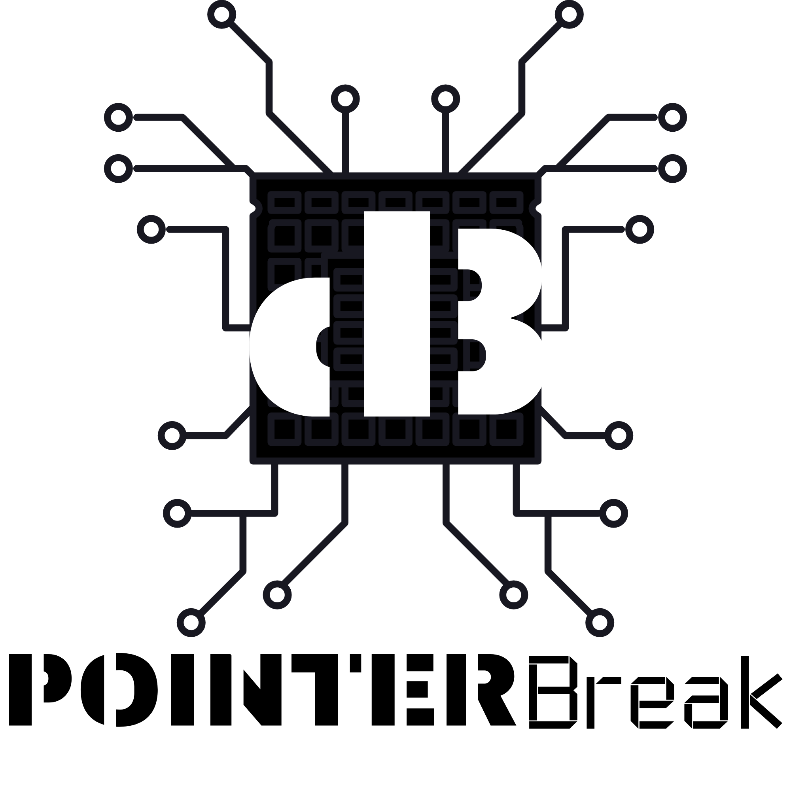

<br>

# 👾 Retro Maze Game 👾

<br>


<br>

> **A retro arcade maze game built with C++17 and raylib.**
> Pick a monster, pick a size, and find your way out before the time runs out.

<br>

---

</div>

## 🗂️ Table of Contents

- [What is PointerBreak?](#-what-is-pointerbreak)
- [Features](#-features)
- [How to Play](#-how-to-play)
- [Screenshots](#-screenshots)
- [How It Works](#-how-it-works)
- [Technologies](#️-technologies)
- [Getting Started](#-getting-started)
- [Tests](#-tests-qa)
- [Project Structure](#-project-structure)
- [Documentation & Presentation](#-documentation--presentation)
- [Team](#-team)
- [Milestones](#-milestones)

---

## 🎮 What is PointerBreak?

**PointerBreak** is a graphical maze game. The player starts in the **top-left corner** and has to reach the **exit in the bottom-right corner**. A new random maze is generated every time, from **10x10** up to **50x50** cells, and the size is chosen by the player.

The name is a pun on **pointers** and **dynamic memory** — the maze lives in a dynamic `int**` array created with `new` and freed with `delete[]` — and on *breaking* out of the maze.

The game logic is completely separated from the graphics: the logic classes use **no raylib and no `cin` / `cout`**, so they can be tested without opening a window.

---

## ✨ Features

| Feature | Details |
|--------|---------|
| 🧱 **Random Mazes** | Generated with the Recursive Backtracker algorithm, a path to the exit always exists |
| 📏 **Adjustable Size** | 10x10 up to 50x50, chosen with buttons so an invalid size is impossible |
| 🚪 **Special Doors** | Blinking orange walls you can cross as a shortcut — placed only where they really save steps |
| 👾 **6 Avatars** | Retro pixel-art monsters, scaled to the cell size with `DrawTexturePro` |
| 🎥 **Smooth Camera** | Follows the player, zooms out to the whole maze on request |
| 💡 **Hint** | Shows the shortest path to the exit for 3 seconds — once per game |
| ⏱️ **3 Difficulties** | Easy, Medium and Hard change the time limit and the number of doors |
| 🏆 **High Scores** | Top 5 for every difficulty, saved in a file, 3-letter arcade names |
| 🔤 **Text View** | Switch to a text maze (`#`, `D`, `@`, `E`) at any time |
| ⏸️ **Pause** | Hides the maze and stops the timer, so it cannot be used to plan the route |
| 🛡️ **Input Validation** | Size, names, score file and missing assets are all checked — the game never crashes |

---

## 🕹️ How to Play

**Goal:** go from the top-left corner to the green exit in the bottom-right corner. You cannot walk through walls — except through the **blinking orange doors**.

| Key | Action |
|-----|--------|
| ⬆️ ⬇️ ⬅️ ➡️ | Move (hold the key to keep walking) |
| `M` (hold) | See the whole maze — you cannot move, the timer keeps running |
| `H` | Hint: the path to the exit for 3 seconds (once per game, costs 20% of the score) |
| `T` | Switch between graphic and text view |
| `P` or `ESC` | Pause |

**Difficulty**

| Level | Time limit | Doors |
|-------|-----------|-------|
| 🟢 Easy | None | Many |
| 🟡 Medium | Generous | Some |
| 🔴 Hard | Tight | Few |

The time limit is calculated from the length of the shortest path, so it is fair for every maze size.

**Score (max 1000):** half of the points are for a short route (few moves), half are for speed. Using the hint costs 20%. If your score is good enough you can enter a 3-letter name in the top 5 table.

---

## 📷 Screenshots

<div align="center">

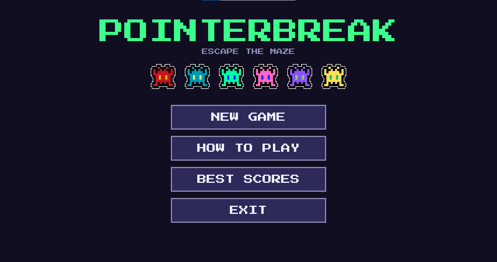
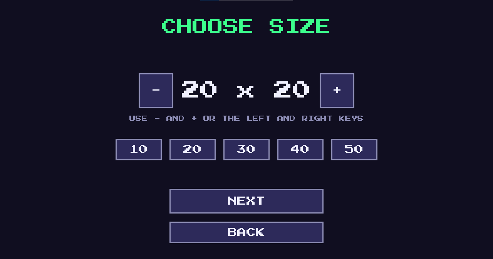
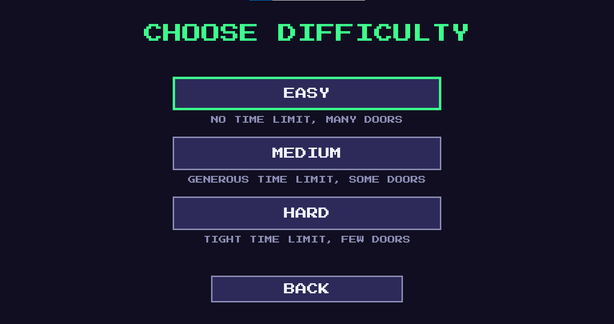
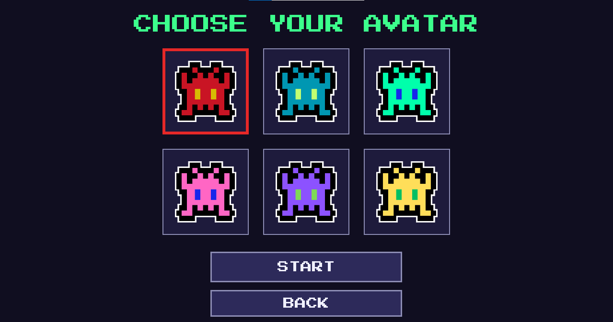
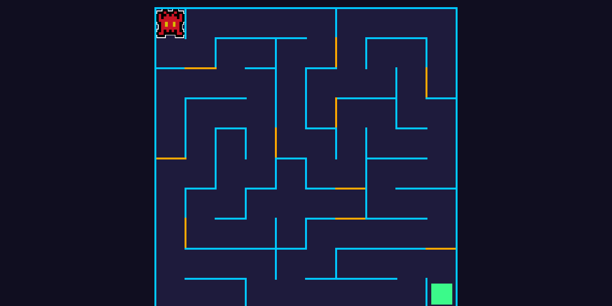

</div>

---

## ⚙️ How It Works

**Screens:**

```
                  ┌── How to Play
                  │
 Main Menu ───────┼── Best Scores
     │            │
     │            └── Exit
     ▼
 Choose Size (10-50) → Choose Difficulty → Choose Avatar → GAME
                                                             │
                                          Pause / Win / Lose ┘
```

**How the maze is stored:** every cell is one `int`. Bits 0-3 are the walls (up, right, down, left), bits 4-7 are doors on those sides. The grid is `int**`, allocated with `new` and released with `delete[]` in the destructor of `MazeGenerator`. Copying the class is forbidden, so the memory can never be freed twice.

**How the maze is generated:**

```
Start at (0,0) → go to a random unvisited neighbour, remove the wall →
when stuck, step back → repeat until every cell is visited →
add shortcut doors where the walk around the wall is at least 10 steps
```

**Shortest path, hint and time limit** all use the same Breadth-First Search (BFS) in `GameLogic`.

**Smooth movement:** the logic jumps from cell to cell, while the drawn position and the camera slide after it. The logic never waits for an animation.

| Class | Responsibility |
|-------|----------------|
| `GameLogic` | Collisions, win check, shortest path (BFS), score, time limit, text maze |
| `MazeGenerator` | Dynamic grid, Recursive Backtracker, shortcut doors |
| `PlayerAvatar` | Position, moves and chosen avatar of the player |
| `ScoreBoard` | Top 5 per difficulty, saved to and loaded from a file |
| `AvatarRenderer` | Loads and draws the avatar textures, smooth sliding |
| `GameplayScreen` | One game: input, timers, hint, camera, pause / win / lose |
| `GameManager` | Window, game loop and the state machine of the screens |

---

## 🛠️ Technologies

<div align="center">

### 💻 Language & Library
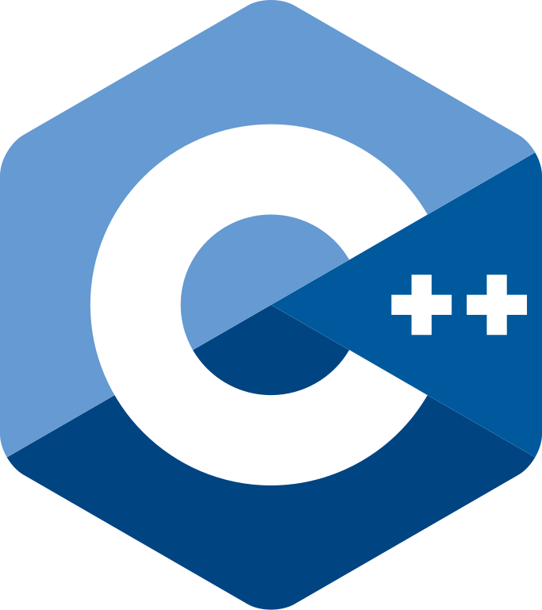
&nbsp;&nbsp;


### 🧰 Tools
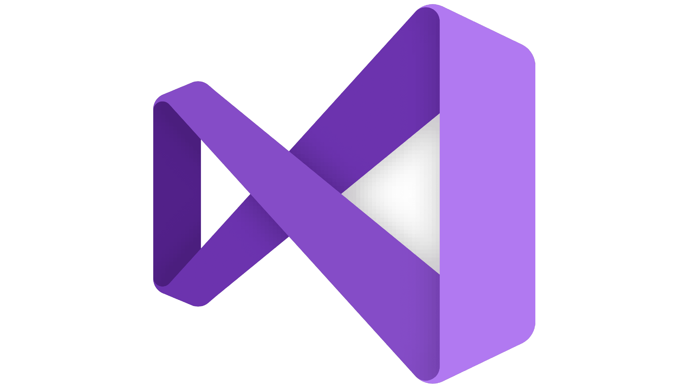
&nbsp;&nbsp;
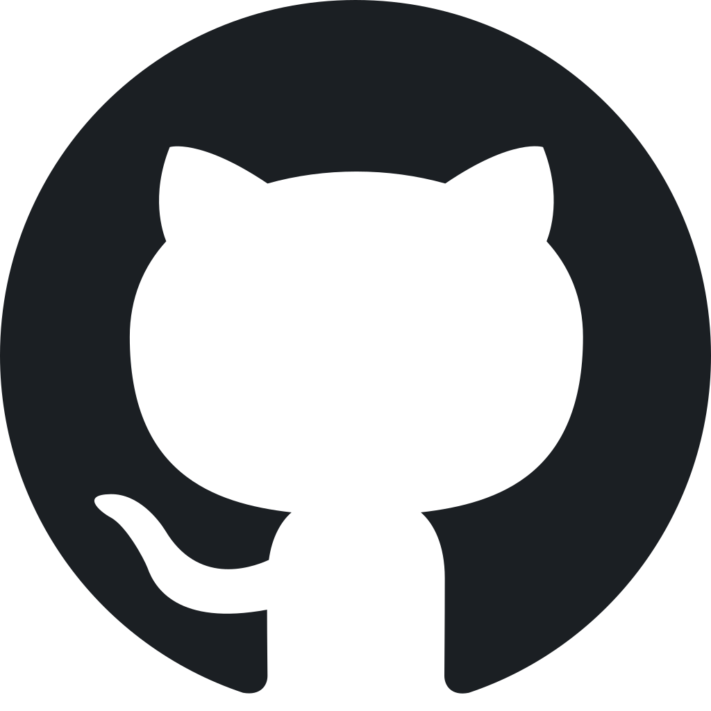

### 🎨 Design
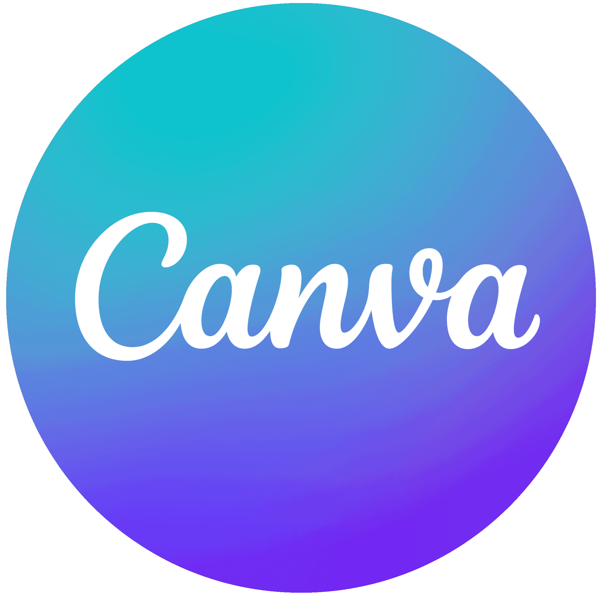

### 📑 Docs & Presentation

&nbsp;&nbsp;
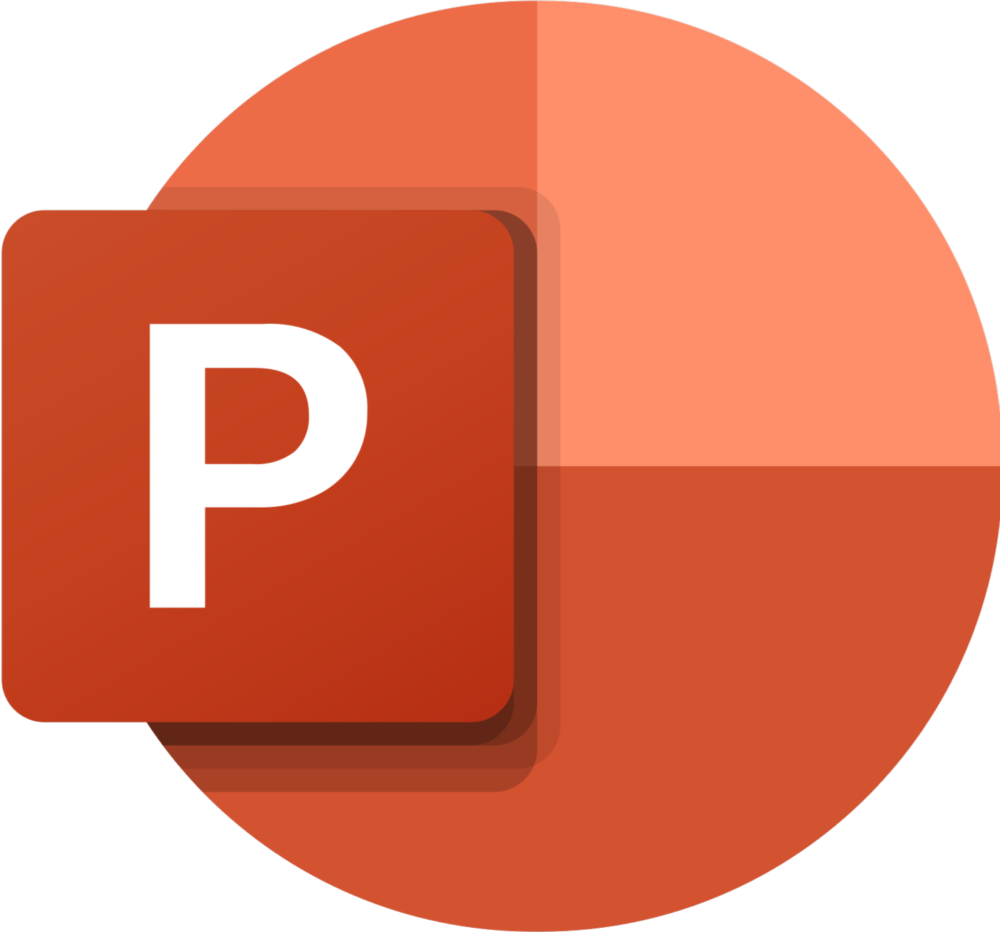

### 💬 Communication
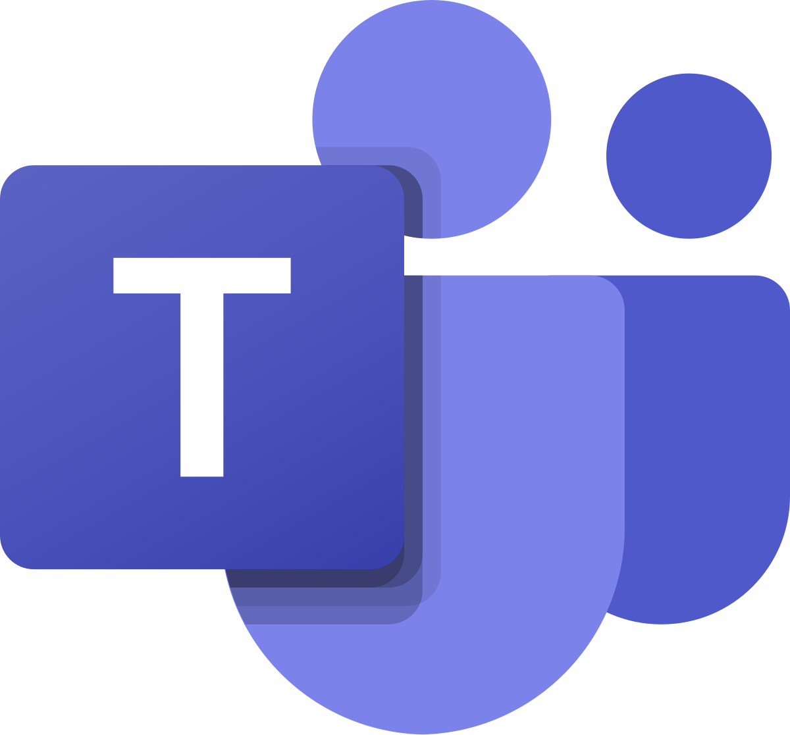

</div>

---

## 🚀 Getting Started

**Requirements:** Windows 10 or 11, Visual Studio 2022 (with the *Desktop development with C++* workload), Git and internet (raylib is downloaded automatically during the first build).

**Clone the repository:**

```bash
git clone 
git clone https://github.com/TSTodorov24/PointerBreak
cd PointerBreak
```

**Visual Studio 2022:**

1. Install the *Desktop development with C++* workload.
2. `File → Open → Folder...` and choose the `PointerBreak` folder.
3. Wait for `CMake generation finished.` in the Output window.
4. Select `PointerBreak.exe` in the startup item list and press `Ctrl+F5`.

**Command line (Developer PowerShell for VS 2022):**

```bash
cmake -B build
cmake --build build --config Release
build\Release\PointerBreak.exe
```

> The `Assets` folder is copied next to the program automatically.

---

## 🧪 Tests (QA)

The logic classes are tested by our own test functions in `Tests/Tests.cpp` — no window and no extra libraries needed. Every check prints `PASS` or `FAIL`.

In Visual Studio select `PointerBreakTests.exe` in the startup item list and press `Ctrl+F5`, or from the command line:

```bash
build\Release\PointerBreakTests.exe
```

**What is tested:** size validation · every maze size 10-50 is solvable · the shortest path never crosses walls · closed outer border · walls and doors are symmetric · wall and door collisions · win condition · player data · time limit per difficulty · score and hint penalty · score table (sorting, top 5, broken file) · text maze · creating and destroying 200 mazes.

**Memory check** (finds leaks and invalid memory access):

```bash
cmake -B build -DENABLE_ASAN=ON
cmake --build build --config Release
build\Release\PointerBreakTests.exe
```

Things that cannot be tested automatically (camera, animation, menus) are covered by the manual plan in [`Docs/QA_ManualTestPlan.md`](Docs/QA_ManualTestPlan.md).

---

## 📂 Project Structure

```text
PointerBreak/
│
├── Assets/                  # Avatars (PNG) and the Press Start 2P font
│
├── Include/                 # Header files
│   ├── Constants.h          # Shared constants and small types
│   ├── GameLogic.h          # Pure game calculations
│   ├── MazeGenerator.h      # Dynamic maze grid and generation
│   ├── PlayerAvatar.h       # Player data
│   ├── ScoreBoard.h         # High score tables
│   ├── AvatarRenderer.h     # Drawing the avatars
│   ├── UiHelper.h           # Colors, text and buttons
│   ├── Screens.h            # Simple menu screens
│   ├── GameplayScreen.h     # The game screen
│   └── GameManager.h        # Window, loop and state machine
│
├── Src/                     # Source files (same names as the headers)
│   └── Main.cpp             # Starts the game
│
├── Tests/
│   └── Tests.cpp            # QA test functions
│
├── Docs/
│   ├── DesignDecisions.md   # What we decided and why
│   └── QA_ManualTestPlan.md # Manual tests
│
├── Media/                   # Images for this README
│   ├── logo/                # Project logo
│   ├── Screenshots/         # Screenshots of the game
│   ├── Team/                # Team photos
│   └── Used/                # Logos of the tools we used
│
├── CMakeLists.txt           # Build configuration
└── README.md                # This file
```

**Code style:** classes, methods and files in `PascalCase` · variables in `camelCase` · class members as `m_camelCase` · constants in `UPPER_CASE`.

---

## 📋 Documentation & Presentation

| 📋 Documentation | 🎤 Presentation |
|-----------------|----------------|
| [View Documentation](https://codingburgas-my.sharepoint.com/:w:/g/personal/tstodorov24_codingburgas_bg/IQDt3bekZa8xQYWRtlQEXWmiAT02vnfA_vjZYafSFo5Wlbc?e=cx25ef) | [View Presentation](https://codingburgas-my.sharepoint.com/:p:/g/personal/tstodorov24_codingburgas_bg/IQAXQy8cPYdERKCzVqDk6VzKAWPLQRtm5S-_Teq94ynP3iI?e=2h3ap2) |

---

## 👥 Team

<div align="center">

| | Name | Class | Role |
|--|------|-------|------|
| 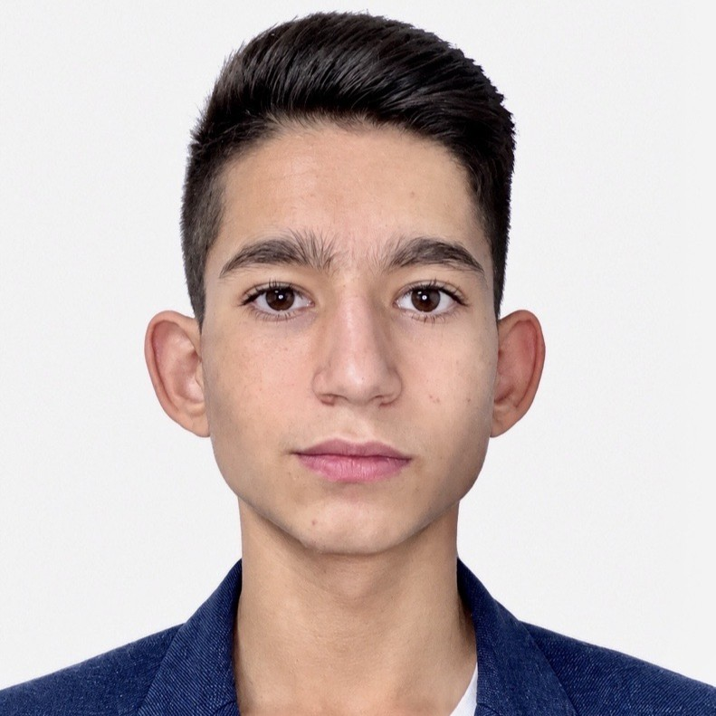 | [**Teodor Todorov**](https://github.com/TSTodorov24) | 10A | 🧭 Scrum Trainer |
| 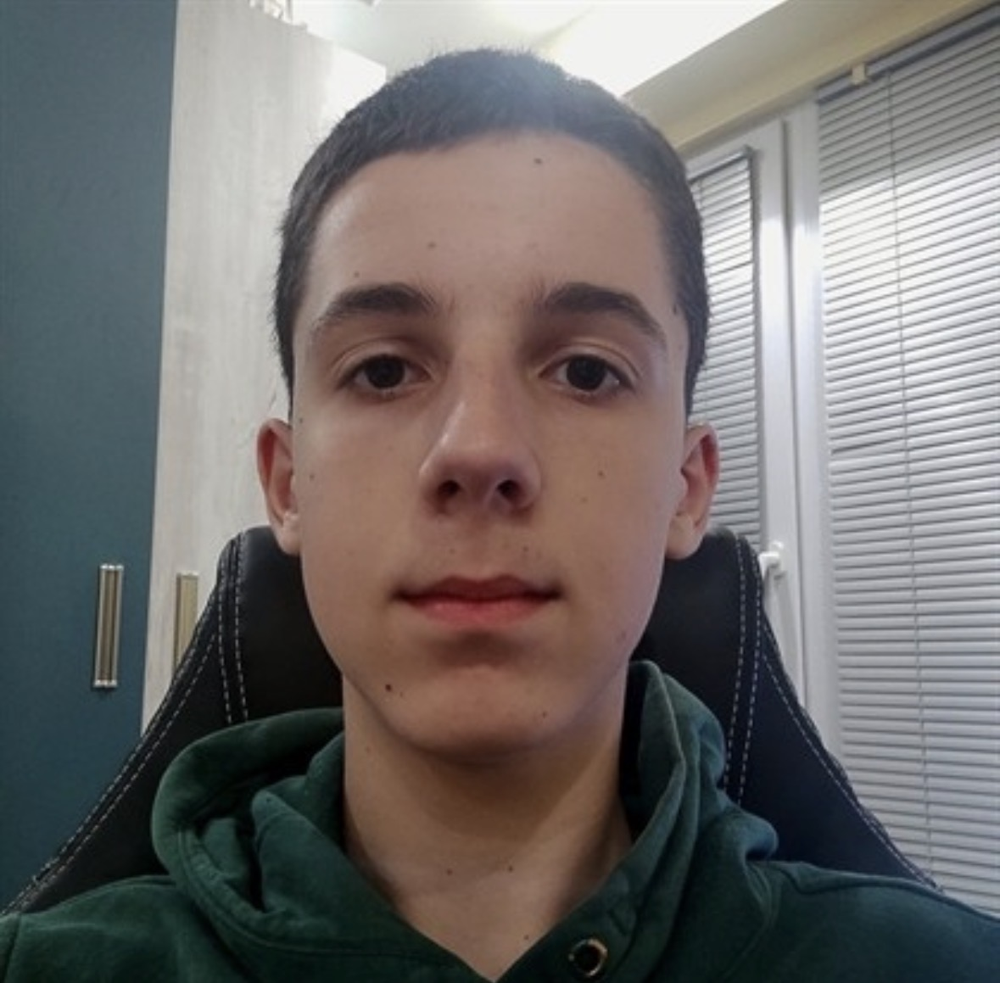 | [**Borislav Andrikov**](https://github.com/BSAndrikov24) | 10B | ⚙️ Backend Developer |
| 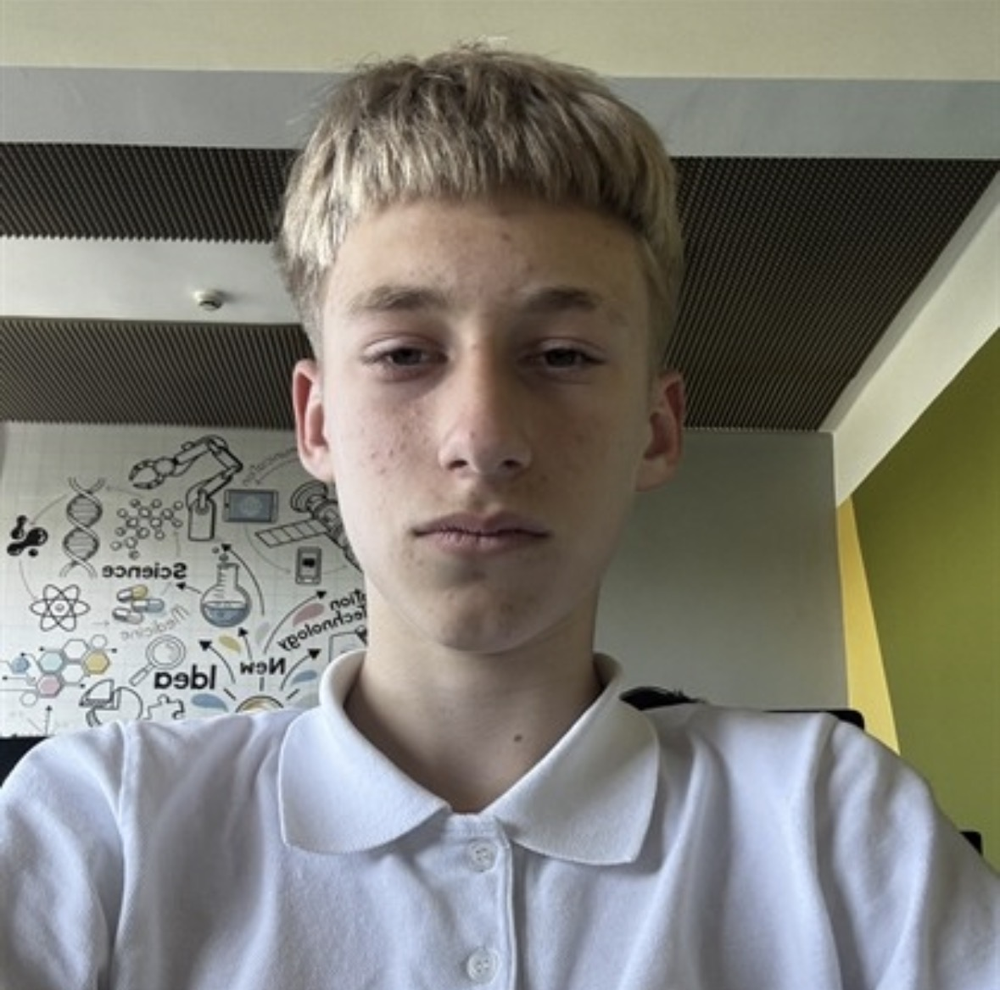 | [**Vasilen Gospodinov**](https://github.com/VZGospodinov24) | 10B | 🔍 Quality Engineer |                       
| 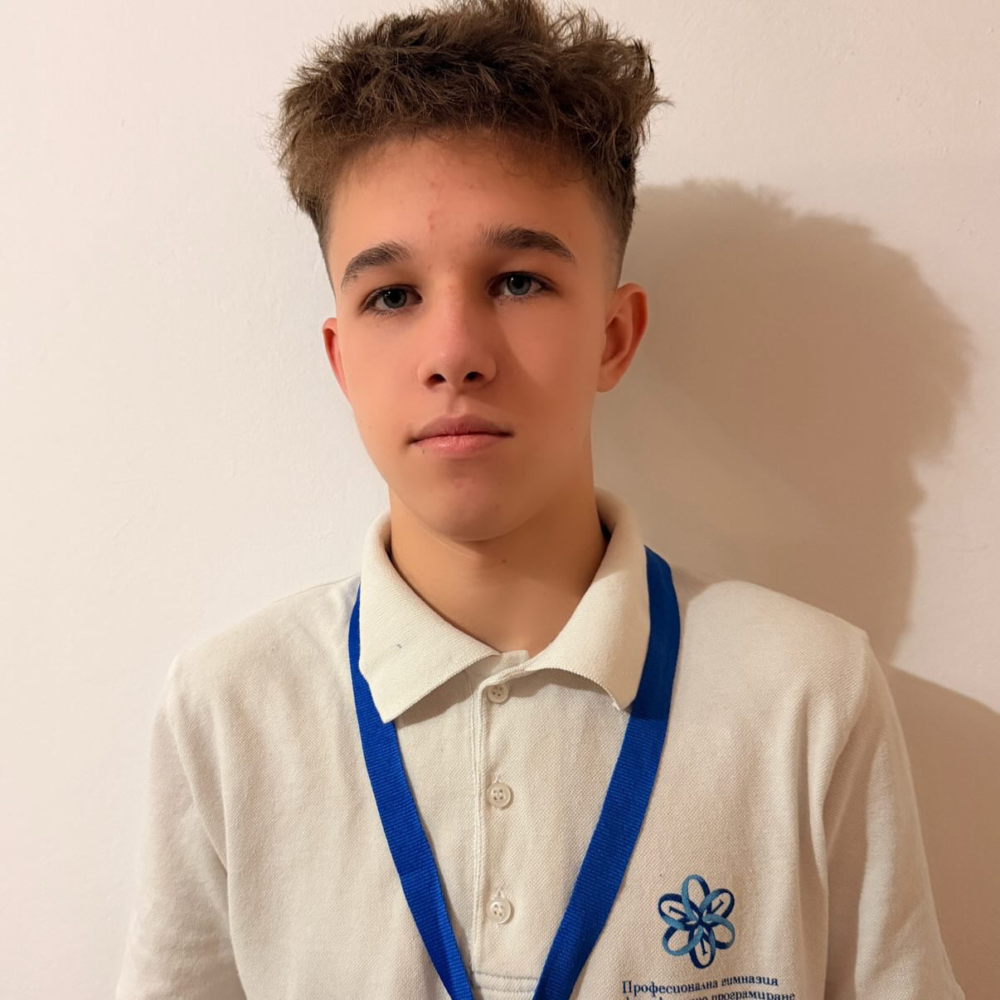 | [**Alexander Kasabov**](https://github.com/AAKasabov24) | 10G | 🎨 Frontend Developer |

</div>

---

## 🎨 Credits

- **Avatars:** *Teodor Todorov*
- **Font:** [Press Start 2P](https://fonts.google.com/specimen/Press+Start+2P) — SIL Open Font License (`Assets/PressStart2P-OFL.txt`)
- **Graphics library:** [raylib](https://www.raylib.com/) — zlib license

---

## 📈 Milestones

```
✅ Phase 1 — Planning the idea, the roles and the GitHub board
✅ Phase 2 — Designing the architecture (game logic separated from the graphics)
✅ Phase 3 — Dynamic maze grid and the Recursive Backtracker generator
✅ Phase 4 — Game logic: movement, doors, BFS shortest path, time limit, scoring
✅ Phase 5 — raylib interface: menus, avatars, smooth camera, text view
✅ Phase 6 — QA: test functions, memory check and manual test plan
✅ Phase 7 — Documentation and presentation
✅ Phase 8 — Final testing, GitHub cleanup and the defense
```

---

<div align="center">

Made with ❤️ by **Team PointerBreak**

</div>
